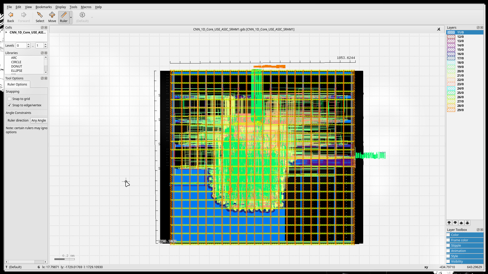

# CNN 1D Core — ASIC Backend Implementation

Backend (physical design) implementation of a 1D Convolutional Neural Network accelerator, targeting **300 MHz** on **45nm GSCLIB045** using **Cadence Innovus**.



## About

This repository serves as a **reference** for the ASIC backend implementation flow of a 1D CNN accelerator core (`CNN_1D_Core_USE_ASIC_SRAM1`).

A complete project report is available at [`docs/CNN_Backend_Implementation.pdf`](docs/CNN_Backend_Implementation.pdf).

## Reproducing the Layout

All input files needed to run the backend flow are provided in the `input_data/` directory:

```
input_data/
├── netlist/          # Post-synthesis gate-level netlists (200/250/300 MHz)
├── sdc/              # Timing constraints (SDC)
├── lib/              # Liberty timing libraries (FF/TT/SS corners)
├── lef/              # Technology + standard cell + SRAM macro LEFs
├── captbl/           # RC parasitic capture table
├── map/              # Stream-out layer mapping
├── mmmc.view         # Multi-Mode Multi-Corner view definition
└── all_lef_files.tcl # LEF loading script
```

Load the MMMC view and netlist into **Cadence Innovus** to generate the layout from scratch.

## Requirements

- **Cadence Innovus** ≥ 22.16
- **Git LFS** — required to clone (the GDS file is ~247 MB)

```bash
git lfs install
git clone https://github.com/TrSonHien/CNN-1D-ASIC-Backend-Implementation.git
```

## License

This project is for educational and academic purposes.
