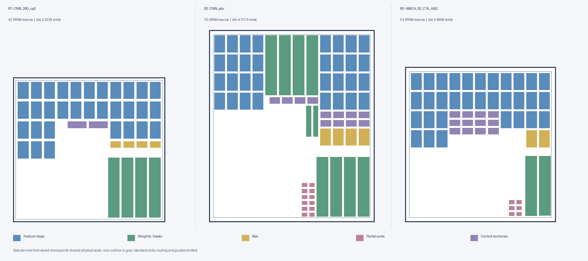

# CNN-1D ASIC Backend Implementation

**Three implementation rounds:** `CNN_300_cp3` → `CNN_adv` → `AMICA_R2_C16_ASIC`.

This repository presents the physical-design results and the AMICA backend
handoff data. The report distinguishes historical implementation results,
later verification configurations, and remaining physical/electrical issues;
it does not claim that every round is signoff-clean.

## Report and physical organization

**[Read the nine-page comparison report](docs/CNN_Three_Stage_Optimization_Report.pdf).**



The comparison is redrawn from measured macro positions in the selected saved
checkpoints, at a shared physical scale. It is not an Innovus screenshot.
Standard cells, routing, halos and placement guides are omitted. The native
historical floorplan/macro-view images are also retained in `images/`; their
stage-identification limits are described in the report.

## Published layout

```text
README.md
LICENSE
THIRD_PARTY_NOTICES.txt
licenses/
├── FreePDK45-Apache-2.0.txt
└── FreePDK45-NOTICE.txt
docs/
└── CNN_Three_Stage_Optimization_Report.pdf
images/
├── CNN_300_cp3_floorplan.png
├── CNN_adv_macro_map.png
├── AMICA_R2_C16_ASIC_floorplan.png
└── optimization_comparison.png
AMICA_R2_C16_ASIC/
├── ARTIFACTS_SHA256SUMS.txt
├── input_data/
│   ├── all_lef_files.tcl
│   ├── mmmc.view
│   ├── lef/
│   ├── lib/
│   ├── captbl/
│   ├── map/
│   ├── sdc/
│   │   ├── constraints.sdc
│   │   └── post_synthesis_constraints.sdc
│   └── netlist/
│       └── AMICA_R2_C16_ASIC_netlist.v
├── output/
│   ├── synthesis/
│   ├── 06_route_opt/
│   ├── 07_timing_closure/
│   └── 09_final_verify_export/
└── rpt/
    ├── synthesis/
    └── ... original Innovus stage, timing and verification reports
```

The existing root-level `SAVED/`, `input_data/`, `output/` and `rpt/`, and the
older report, are preserved from the previous baseline publication. They are
**not AMICA data**. Use the explicitly named `AMICA_R2_C16_ASIC/` folder for
this handoff. The layout above shows the new publication, not a relabeling of
those existing baseline files.

## AMICA inputs and outputs

- **Physical/timing inputs:** LEF, Liberty, capacitance table, stream-out map,
  LEF-loader configuration and MMMC views, preserving the project's contents.
- **Constraints:** the input SDC and the generated post-synthesis SDC. Both
  specify `clk_sys` at 4 ns; constraints are evidence of the target, not by
  themselves evidence of timing closure.
- **Netlist:** the Genus-generated gate-level netlist, not RTL source. The
  original synthesis netlist/SDC are also retained under `output/synthesis/`.
- **Implementation outputs:** the original available stage outputs, including
  the saved timing-closure/final-export bundles and exported DEF, GDS, netlist,
  SDC and parasitics. Numbering gaps follow the source; missing stages are not
  fabricated or renumbered.
- **Reports:** synthesis reports plus the original Innovus reports, including
  timing/power and physical checks. Historical and later verification report
  directories are preserved rather than merged into one purported result.

No RTL, standalone Genus/Innovus flow scripts, report LaTeX source, EDA
installers or EDA license keys are added. Native checkpoint dependency and
configuration Tcl files remain inside the saved output bundles; the two
input configuration files are also intentionally retained.

### Compression and integrity

The final raw GDS exceeds GitHub's regular-file size limit. It is stored as
`AMICA_R2_C16_ASIC.gds.gz`, with lossless gzip compression; its decompressed
SHA-256 was checked against the original. No new Git LFS storage is required
for the AMICA addition. Existing legacy LFS files are unchanged.

Check the published files before decompressing:

```sh
cd AMICA_R2_C16_ASIC
sha256sum -c ARTIFACTS_SHA256SUMS.txt
```

Decompress the GDS when needed, retaining the published `.gz`:

```sh
gunzip -k output/09_final_verify_export/runs/20261107_205258_226161_1794059578853175/AMICA_R2_C16_ASIC.gds.gz
```

Original native export manifests still refer to the uncompressed GDS. Restore
that file before checking those original manifests. Zero-byte reports and
hidden generated files are retained. Shared input-directory symlinks were
materialized as real files so the GitHub copy does not depend on a lab path.

### Portability and scope

Native checkpoint metadata, `LATEST_COMPLETE` pointers and MMMC configuration
retain their original path references. They require deliberate path rebasing
and compatible licensed EDA tools before use on another machine. This is a
published backend data/results handoff, **not** a claimed turnkey flow or a
newly executed signoff run. No EDA jobs were run for this upload.

## Attribution

See [third-party notices](THIRD_PARTY_NOTICES.txt) and `licenses/`. Original
technology-file headers are retained. The root MIT license does not override
third-party rights. SRAM LEF/Liberty models are project abstracts, not a claim
of qualified foundry views.
